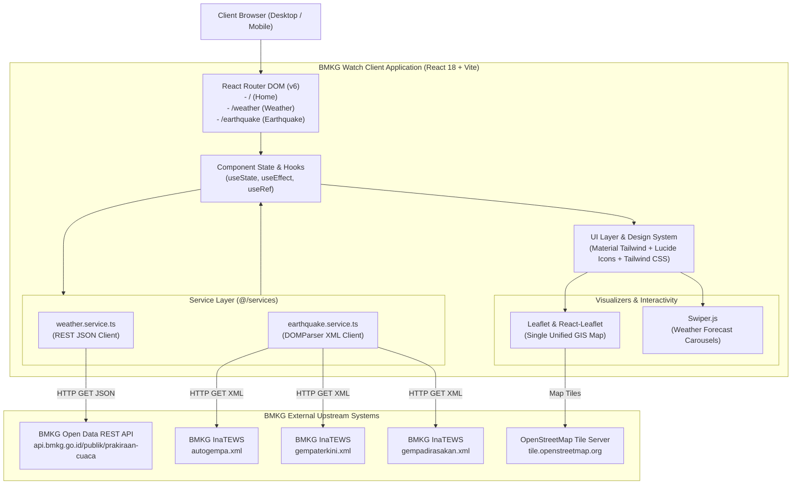

# Architecture & Technical Design Document
## BMKG Watch — System Design & Engineering Specifications

---

| Property | Specification |
| :--- | :--- |
| **Application** | **BMKG Watch** |
| **Architecture Version** | 2.0 (Modernized SPA) |
| **Pattern** | Component-Driven Single Page Application (SPA) |
| **Language & Runtime** | TypeScript 5.2.2 / Node.js 18+ |
| **Target Distribution** | Static Web Application (ESNext / HTML5) |

---

## 1. High-Level System Architecture

BMKG Watch is structured as a pure Client-Side Rendered (CSR) Single Page Application. It directly interfaces with public BMKG and InaTEWS endpoints using standard browser `fetch` APIs.



---

## 2. Technology Stack & Decision Rationale

| Component | Technology | Rationale |
| :--- | :--- | :--- |
| **UI Framework** | React 18.2.0 | Established ecosystem, native support for concurrent rendering, `React.lazy` code splitting, and battle-tested GIS/carousel integrations. |
| **Language** | TypeScript 5.2.2 | Guarantees strict type safety for complex geospatial and meteorological payloads, eliminating runtime `TypeError` risks. |
| **Build Tooling** | Vite 5.2.0 + SWC | Instant HMR development cycles via `@vitejs/plugin-react-swc` and highly configurable Rollup output bundling. |
| **Styling** | Tailwind CSS 3.4.4 | Zero-runtime CSS utility framework enabling surgical enforcement of the *flat accent design system*. |
| **GIS Mapping** | Leaflet 1.9.4 + React-Leaflet 4.2.1 | Industry-standard lightweight mapping engine offering high rendering throughput and custom HTML marker flexibility without DOM overhead. |
| **Carousel Slider** | Swiper 11.1.4 | Touch-optimized, hardware-accelerated transitions for multi-interval weather forecasts on mobile screens. |
| **Iconography** | Lucide Icons (`react-icons/lu`) | Modern, sharp vector strokes that perfectly align with square-cornered, high-contrast layouts. |

---

## 3. Project Directory Structure

The project follows a domain-driven modular structure:

```
bmkg-watch/
├── public/                 # Static public assets (favicon, svg flags)
│   ├── favicon.png
│   └── images/locales/     # Locale indicator flags (en.svg, id.svg)
├── src/
│   ├── components/         # Modular UI components
│   │   ├── earthquake/     # Seismic domain components
│   │   │   ├── earthquake-detail.tsx
│   │   │   ├── earthquake-detail-skeleton.tsx
│   │   │   ├── earthquake-item.tsx
│   │   │   ├── earthquake-list.tsx
│   │   │   ├── earthquake-list-skeleton.tsx
│   │   │   └── earthquake-map.tsx         # Unified GIS Canvas
│   │   ├── weather/        # Meteorological domain components
│   │   │   ├── weather-content.tsx        # Swiper-based daily forecast
│   │   │   ├── weather-icon.tsx           # Lucide icon mapper
│   │   │   └── weather-parameter.tsx      # Metric widget
│   │   ├── navbar.tsx      # Global navigation header
│   │   └── footer.tsx      # Global footer with disclaimers
│   ├── constants/          # Constant datasets & registries
│   │   ├── card.ts         # Cardinal wind directions dictionary
│   │   ├── province.ts     # Province name list
│   │   ├── regions.ts      # Hierarchical province-to-ADM4 registry
│   │   ├── weather.ts      # BMKG weather code descriptions
│   │   └── index.ts        # Barrel export
│   ├── pages/              # Top-level route pages
│   │   ├── home-page.tsx       # Integrated overview dashboard
│   │   ├── earthquake-page.tsx # Seismic monitoring portal
│   │   └── weather-page.tsx    # 140+ city forecast portal
│   ├── services/           # External API abstraction layer
│   │   ├── earthquake.service.ts # InaTEWS XML fetcher & DOMParser
│   │   ├── weather.service.ts    # BMKG REST JSON client
│   │   └── index.ts
│   ├── types/              # TypeScript interface definitions
│   │   ├── earthquake.ts   # Seismic models (NewestEarthquake, EarthquakeData)
│   │   ├── weather.ts      # Weather REST response models
│   │   └── index.ts
│   ├── utils/              # Calculation & formatting utilities
│   │   ├── weather.ts      # Date/time formatting, timezone resolution (WIB/WITA/WIT), wind names
│   │   └── index.ts
│   ├── app.tsx             # Root router & suspense fallback wrapper
│   ├── main.tsx            # DOM mounting entry point
│   └── index.css           # Tailwind directives & flat CSS overrides
├── docs/                   # Engineering documentation (PRD, Architecture, Evaluation)
├── tailwind.config.js      # Tailwind CSS configuration
├── tsconfig.json           # TypeScript configuration with @/* aliases
└── vite.config.ts          # Build configuration & manual chunks strategy
```

---

## 4. Data Layer & API Architecture

### 4.1 Weather Service (`weather.service.ts`)
Consumes BMKG's Open Data REST API parameterized by 4th-level administrative boundary codes (`adm4`):
```typescript
export const fetchWeather = async (
  adm4: string = DEFAULT_ADM4,
): Promise<BmkgWeatherResponse | null> => {
  const url = `https://api.bmkg.go.id/publik/prakiraan-cuaca?adm4=${encodeURIComponent(adm4)}`;
  const response = await fetch(url);
  if (!response.ok) throw new Error(`HTTP error ${response.status}`);
  return await response.json();
};
```
*Response Structure & Regional Localization:*
- `lokasi`: Geospatial metadata (latitude, longitude, province, regency, sub-district, timezone).
- `data[0].cuaca`: Two-dimensional array (`BmkgWeatherEntry[][]`) grouped into consecutive daily slices (3 days, 8 intervals per day = 24 forecast entries).
- **Timezone Localization (`getTimezoneAbbr`)**: Converts IANA strings (`Asia/Jakarta`, `Asia/Makassar`, `Asia/Jayapura`) into dynamic local designations (**WIB**, **WITA**, **WIT**) instead of hardcoded values.
- **Seismic Time Sanitization (`formatEarthquakeTime`)**: Ensures timestamps received from InaTEWS feeds retain clean single timezone suffixes without duplicate strings.

### 4.2 Seismic Service (`earthquake.service.ts`)
Fetches XML feeds from InaTEWS and parses payloads using the browser's native `DOMParser`:
```typescript
const parser = new DOMParser();
const xmlDoc = parser.parseFromString(text, 'application/xml');
```
*Endpoints:*
1. `fetchNewestEarthquake()` $\rightarrow$ `autogempa.xml` (single latest event with Shakemap reference).
2. `fetchEarthquake5Min()` $\rightarrow$ `gempaterkini.xml` (last 15 events $M \ge 5.0$).
3. `fetchEarthquakeFelt()` $\rightarrow$ `gempadirasakan.xml` (last 15 felt events with MMI data).

---

## 5. Interactive GIS Mapping Architecture

### 5.1 Evolution from Multi-Map to Unified Canvas
Legacy implementations mounted separate Leaflet map instances for every earthquake card ($\approx 31$ map instances per page load), resulting in severe memory leaks and frame stuttering.

The current design utilizes a **Single Unified Canvas** (`earthquake-map.tsx`):
1. A single `<MapContainer>` instance renders the entire Indonesian archipelago.
2. All earthquake points are represented as `<Marker>` instances using custom HTML badges (`L.divIcon`) styled with flat square borders (`border-radius: 0px`).
3. The `<MapController>` component listens to `selectedCoord`. When a user clicks *"Center on Map"* on any card, Leaflet smoothly transitions using `map.flyTo(targetCoord, 8, { duration: 1.2 })`.
4. A `<ResetViewButton>` control allows one-click recentering back to default Indonesian bounds `[-2.5, 118]` at zoom level 5.

---

## 6. Styling Architecture & Design System

Styling is engineered using Tailwind CSS combined with centralized overrides in `src/index.css`:
- **Leaflet Popup Flattening**: Strips Leaflet's default `12px` rounded corners, curved bubble tip (`display: none`), and heavy drop shadows in favor of a crisp `border-radius: 0 !important`, `box-shadow: none !important`, and `1px solid #d1d5db` square container with flat close button.
- **Leaflet Zoom Controls**: Overrides `.leaflet-bar` and zoom anchors (`+` / `-`) to use square borders (`0px border-radius`) with zero drop shadows.
- **Swiper Navigation Override**: Converts rounded carousel arrows into high-contrast monochrome rectangular buttons with responsive hover feedback.
- **Modal & Dialog Overrides**: Material Tailwind dialogs are enforced to `!rounded-none !shadow-none border border-gray-300` with custom header bars and flat dismiss buttons.
- **Native Flat Form Elements**: Custom `<select>` dropdowns enforced to `rounded-none border border-gray-300 bg-white h-10 px-3 py-2 text-xs font-bold text-gray-900` replacing Material Tailwind's rounded Select primitives.
- **Vector Iconography (`WeatherIcon`)**: Direct mapping of weather codes to Lucide React SVG vector strokes, eliminating external 3D gradient image dependencies.

---

## 7. Build Strategy & Performance Optimization

Configured in `vite.config.ts` to isolate external dependencies into discrete Rollup chunks:

```typescript
build: {
  rollupOptions: {
    output: {
      manualChunks: {
        'vendor-react': ['react', 'react-dom', 'react-router-dom'],
        'vendor-leaflet': ['leaflet', 'react-leaflet'],
        'vendor-swiper': ['swiper'],
        'vendor-ui': ['@material-tailwind/react', 'react-icons'],
      },
    },
  },
}
```

### Advantages:
1. **Long-Term Browser Caching**: Application code updates do not invalidate cached third-party bundles (e.g., Leaflet or React).
2. **Route-Level Lazy Loading**: Routes (`HomePage`, `EarthquakePage`, `WeatherPage`) are wrapped in `React.lazy()` and `Suspense`, ensuring users only download the code required for their immediate view.

---

## 8. Security & Network Considerations

- **Strict HTTPS**: All external calls to BMKG servers are made over secure TLS connections.
- **CORS Considerations**: Public BMKG endpoints currently send permissive `Access-Control-Allow-Origin: *` headers. Should CORS restrictions be introduced, the client can be proxied seamlessly via Netlify Functions or edge serverless middleware.
- **Privacy by Design**: The application maintains zero persistence of user credentials or personal tracking data, ensuring total compliance with global privacy regulations (GDPR / PDP).
