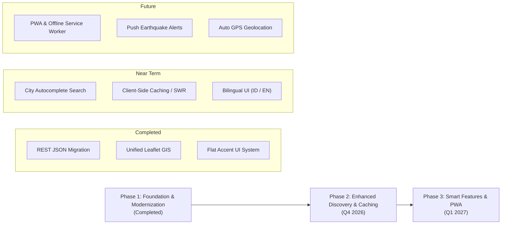

# Product Requirements Document (PRD)
## BMKG Watch — Indonesian Meteorology & Seismic Monitoring Portal

---

| Document Detail | Information |
| :--- | :--- |
| **Product** | **BMKG Watch** |
| **Document Version** | 1.1.0 |
| **Status** | Active / In Development |
| **Last Updated** | October 14, 2026 |
| **Data Sources** | Open Data BMKG & InaTEWS (Indonesia Tsunami Early Warning System) |
| **Application Type** | Client-Side Single Page Application (SPA) Web |

---

## 1. Executive Summary & Product Vision

### 1.1 Vision
To deliver a **fast, accurate, lightweight, and accessible** monitoring portal for meteorological (weather) and geophysical (earthquake) events across Indonesia, eliminating reliance on bloated or slow government portals during crisis situations.

### 1.2 Mission
1. **Data Transparency**: Present open public data from BMKG in a modern, clean, and intuitive visual format.
2. **High Performance**: Maximize load efficiency through route-level code splitting, unified GIS mapping architecture, and a flat accent interface.
3. **Broad Accessibility**: Guarantee flawless mobile-first responsiveness and high-contrast typography across all desktop and mobile screen sizes.

---

## 2. Background & Problem Statement

### 2.1 Current Pain Points
1. **Infrastructure Instability During Disasters**: Official government portals frequently suffer severe latency or timeouts when significant earthquakes occur due to sudden traffic spikes.
2. **Legacy Data Migration**: BMKG has transitioned its weather services from deprecated XML feeds to a new REST JSON API. Many third-party clients remain broken or unadapted.
3. **Excessive Client DOM Bloat**: Rendering separate interactive maps for each earthquake item in a list overwhelms mobile browser memory, leading to frame drops and crashes.
4. **Complex Regional Navigation**: Finding sub-district or city-level forecasts often requires navigating multi-step, cumbersome directory trees.
5. **Timezone Uniformity Fallacy**: Naive implementations frequently hardcode "WIB" across all regions, misrepresenting actual local times for central (WITA) and eastern (WIT) Indonesia.

### 2.2 The BMKG Watch Solution
- **Native BMKG REST JSON Migration**: Fully integrated with BMKG's latest official REST endpoint for 3-day weather forecasts at 3-hour intervals.
- **Dynamic 3-Zone Indonesian Timezone Localization**: Automatically maps IANA timezone attributes (`Asia/Jakarta`, `Asia/Makassar`, `Asia/Jayapura`) to their respective standard designations (**WIB**, **WITA**, **WIT**) for 100% temporal accuracy.
- **Unified GIS Mapping Architecture**: All 30+ earthquake coordinates (latest event, M 5.0+, and felt tremors) are consolidated into a single high-performance Leaflet canvas with dynamic filtering and smooth fly-to animations.
- **Flat Accent Design System**: Adopted a geometric, square-edged UI (`0px border-radius`) with high-contrast functional color accents for instant readability of numerical metrics (magnitude, depth, temperature, humidity) and zero-radius popups/modals.

---

## 3. Target Audience & User Personas

| Persona | Profile | Core Needs |
| :--- | :--- | :--- |
| **General Public & Local Residents** | Citizens checking daily local weather and verifying sudden earthquake tremors. | Instant load speed, clear tsunami warning status, straightforward weather condition indicators. |
| **Travelers & Commuters** | Individuals traveling between Indonesian cities and provinces. | 3-day multi-interval forecasts with dynamic regional timezones (WIB/WITA/WIT), wind speed/direction, humidity, and rapid city switching. |
| **Disaster Responders & Analysts** | Safety volunteers and geology/weather enthusiasts. | Exact coordinates (latitude/longitude), hypocenter depth, BMKG Shakemap visualization, and felt MMI intensity scales. |

---

## 4. Product Scope & Core Features

### 4.1 Home Dashboard Module (`/`)
- **Official Open Data Notice**: Banner highlighting synchronization with official BMKG open systems, with aligned direct links to `bmkg.go.id`.
- **Selected City Weather Overview**:
  - Quick-switch chips for top metropolitan areas (Jakarta, Bandung, Surabaya, Semarang, Yogyakarta).
  - Native flat dropdown selector covering popular Indonesian cities with identical `h-10` dimensions.
  - Today's weather forecast presented in an interactive 3-hour interval Swiper carousel.
  - Dynamic local time indicator showing actual regional timezone (e.g., `Pukul 08:00 WITA`).
  - Core metrics: Temperature (°C), relative humidity (%), wind speed (km/h), and cardinal wind direction translated into Indonesian.
- **Latest Earthquake Highlight Card**:
  - Real-time display of the single most recent seismic event.
  - High-visibility red magnitude badge.
  - Interactive BMKG Shakemap preview with flat modal dialog expansion (including custom flat dismiss button).
  - Comprehensive parameters: Epicenter region, magnitude, depth, coordinates, clean timestamp, tsunami potential, and MMI felt intensity.
  - Direct CTA linking to the full interactive earthquake map.

### 4.2 Comprehensive Weather Module (`/weather`)
- **Two-Tier Regional Filtering**:
  - Province selector: Covers all 34 Indonesian provinces using zero-radius native select elements.
  - Regency / City selector: Covers 140+ administrative regencies and cities mapped to official BMKG ADM4 codes.
- **3-Day Multi-Interval Forecast**:
  - Date-based grouping with localized Indonesian headers (e.g., *Selasa, 14 Oktober 2026*).
  - Swiper carousel slider with flat geometric monochrome navigation controls.
  - Automatic daytime vs. nighttime status indicator based on local time intervals.
  - 14 distinct Lucide flat vector weather icons mapped to official BMKG condition codes (Clear, Partly Cloudy, Light Rain, Thunderstorm, Fog, Smoke, etc.) rendered directly with semantic accent colors.
  - Dynamic regional timezone labels (WIB for Western, WITA for Central, WIT for Eastern Indonesia).
  - Meteorological parameters: Ambient temperature, humidity, wind speed, and direction.

### 4.3 Unified Seismic & Earthquake GIS Module (`/earthquake`)
- **Latest Event Detail Bar**: Full-width metric banner displaying hypocenter depth, coordinates, tsunami status, and expandable shakemap modal.
- **Unified Interactive GIS Map**:
  - Single interactive Leaflet canvas utilizing OpenStreetMap tiles.
  - Custom flat square markers (`30x30px`, `border-radius: 0px`) with magnitude labels and color-coded severity:
    - **Dark Red**: Latest earthquake event.
    - **Bright Red**: 15 earthquakes with Magnitude $\ge$ 5.0.
    - **Amber**: 15 felt earthquakes reported by the public (MMI scale).
  - Category filter toggles: *All Earthquakes*, *M 5.0+*, and *Felt*.
  - Map control button to reset viewport to central Indonesia `[-2.5, 118]`.
  - Smooth fly-to camera animation upon clicking any earthquake item from the lists.
  - **Flat Leaflet Popups**: Completely customized popup bubble with 0px border-radius, zero drop shadows, clean borders, flat square close button, and structured metadata headers.
- **Dual Seismic History Lists**:
  - Left column: 15 recent earthquakes with Magnitude $\ge$ 5.0.
  - Right column: 15 recent felt earthquakes.
  - *"Center on Map"* action button on each card triggering instant coordinate focus.

### 4.4 Global Navigation & Footer
- **Navbar**: Clean flat header with brand link, navigation items (Home, Weather, Earthquake), and a responsive mobile collapse menu.
- **Footer**:
  - Brand statement & open data compliance tag.
  - Quick service navigation links.
  - Direct official BMKG resources (`bmkg.go.id`, `inatews.bmkg.go.id`).
  - Independent developer profile section with explicit disclaimer that social accounts (LinkedIn, GitHub, Instagram, Portfolio) belong to the developer and are not affiliated with BMKG.

---

## 5. Functional Requirements

| ID | Module | Requirement Description | Priority |
| :--- | :--- | :--- | :--- |
| **FR-01** | Seismic | The system shall fetch the latest single earthquake event from `autogempa.xml` on initial page load. | P0 |
| **FR-02** | Seismic | The system shall fetch the last 15 M 5.0+ earthquakes (`gempaterkini.xml`) and 15 felt earthquakes (`gempadirasakan.xml`). | P0 |
| **FR-03** | Seismic | The system shall plot all retrieved earthquake coordinates onto a single interactive Leaflet map canvas. | P0 |
| **FR-04** | Seismic | The user shall be able to click on any earthquake item to smoothly pan and zoom the map (*fly-to*) to its epicenter coordinates. | P1 |
| **FR-05** | Seismic | The user shall be able to preview and expand the official BMKG Shakemap image inside a flat square modal dialog. | P1 |
| **FR-06** | Weather | The system shall query the BMKG REST JSON API (`api.bmkg.go.id/publik/prakiraan-cuaca`) using administrative ADM4 codes. | P0 |
| **FR-07** | Weather | The user shall be able to select any province and city from the preconfigured registry to retrieve localized forecasts. | P0 |
| **FR-08** | Weather | The system shall format forecast intervals into human-readable Indonesian date strings and local time stamps. | P1 |
| **FR-09** | Weather | The system shall dynamically resolve and display the appropriate Indonesian timezone abbreviation (WIB, WITA, WIT) based on region metadata. | P0 |
| **FR-10** | Weather | The system shall render corresponding flat vector weather icons based on BMKG weather codes or text description fallbacks. | P1 |
| **FR-11** | Weather | The system shall determine whether each forecast slot represents daytime (06:00 - 17:59) or nighttime (18:00 - 05:59). | P2 |
| **FR-12** | General | The system shall display skeleton loaders while asynchronous API queries are pending. | P1 |
| **FR-13** | General | The system shall display accessible error notifications if external BMKG endpoints fail or return empty datasets. | P1 |

---

## 6. External Data Integrations

### 6.1 Seismic Feeds (BMKG InaTEWS XML)
1. **Latest Earthquake (Autogempa)**:
   - Endpoint: `https://data.bmkg.go.id/DataMKG/TEWS/autogempa.xml`
   - Format: XML
   - Schema: Date, Time, Coordinates, Latitude, Longitude, Magnitude, Depth, Region, Tsunami Potential, Felt, Shakemap filename.
2. **15 Earthquakes M 5.0+**:
   - Endpoint: `https://data.bmkg.go.id/DataMKG/TEWS/gempaterkini.xml`
   - Format: XML
3. **15 Felt Earthquakes**:
   - Endpoint: `https://data.bmkg.go.id/DataMKG/TEWS/gempadirasakan.xml`
   - Format: XML

### 6.2 Meteorology Feed (BMKG Open Data REST JSON API)
- **Endpoint**: `https://api.bmkg.go.id/publik/prakiraan-cuaca?adm4={ADM4_CODE}`
- **Format**: JSON
- **Method**: HTTP GET
- **Parameter**: `adm4` (Ministry of Home Affairs / BMKG 4th-level administrative boundary code, e.g., `31.71.03.1001` for Gambir, Central Jakarta).

---

## 7. UI/UX Design System Specifications (Flat Accent System)

### 7.1 Core Principles
1. **Geometric Precision**: Strict `border-radius: 0px` across all cards, buttons, badges, Leaflet popups, and dialog overlays.
2. **Neutral High-Contrast Canvases**: Uniform borders (`border-gray-200` to `border-gray-300`) over clean neutral surfaces (`bg-white`, `bg-gray-50`).
3. **Functional Color Coding**:
   - **Crimson Red (`bg-red-600`, `text-red-600`)**: Latest earthquakes, events M $\ge$ 5.0, critical seismic warnings.
   - **Amber (`bg-amber-600`, `text-amber-900`)**: Felt earthquakes, advisory notes, daytime status.
   - **Cobalt Blue (`bg-blue-600`, `text-blue-600`)**: Primary actions, weather telemetry, MMI markers.
   - **Teal (`bg-teal-700`)**: Official open-data verified tags.
   - **Graphite (`bg-gray-900`)**: Primary CTA buttons and key headings.

---

## 8. Non-Functional Requirements

1. **Performance & Bundle Splitting**:
   - Third-party packages split into dedicated chunks: `vendor-react`, `vendor-leaflet`, `vendor-swiper`, `vendor-ui`.
   - First Contentful Paint (FCP) targeted at $\le 1.5$ seconds under standard 4G networks.
2. **Accessibility (a11y)**:
   - Compliance with WCAG 2.1 AA standards for color contrast ($\ge 4.5:1$ for normal body copy).
   - Semantic HTML5 structure throughout (`header`, `main`, `section`, `footer`).
   - Accessible labels on form selectors and interactive buttons.
3. **Cross-Browser Compatibility**:
   - Full compatibility with evergreen browsers (Chrome, Firefox, Safari, Edge) across desktop, iOS, and Android.
4. **Type Safety**:
   - Zero compilation errors under strict TypeScript compiler settings.

---

## 9. Edge Cases & Resilience Strategy

1. **BMKG API Downtime / Throttling**:
   - When network calls fail, the interface renders a structured alert card detailing that external BMKG servers are unreachable, allowing retries without crashing the page.
2. **Coordinate Parsing Variances**:
   - The parser supports both standard comma-delimited strings (`split(',')`) and degree notation (`LS`/`LU` for south/north latitudes, `BT`/`BB` for east/west longitudes), converting them into decimal `[lat, lon]` pairs.
3. **Empty Regional Forecasts**:
   - If BMKG returns an empty `data[0].cuaca` array for remote regions, an explicit empty-state message is shown.

---

## 10. Phased Product Roadmap

---

## 11. Success Metrics & Key Performance Indicators (KPIs)

- **Lighthouse Performance Score**: $\ge 90$ across both desktop and mobile viewports.
- **Map Interaction Latency**: $\le 1.0$ second from item click to coordinate fly-to completion.
- **Parsing Error Rate**: $< 0.1\%$ across active user sessions.
- **City Access Friction**: Users must be able to view their desired city's weather in $\le 2$ interactions from the landing page.
